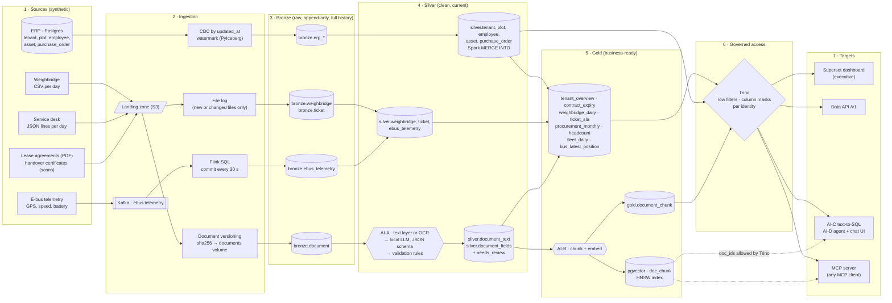

# iceberg-ai-lakehouse

An open-source **AI lakehouse** that runs on one machine: Apache Iceberg tables behind an Iceberg REST
catalog, batch and streaming pipelines, one governance layer, and an AI layer powered by a **local LLM on
your GPU**. Nothing leaves the machine.

The scenario is a **fictional industrial estate**: an estate operator with tenants, leases, a weighbridge at
the gate, a service desk, an ERP and an electric shuttle bus fleet. All data is synthetic.

The goal is a reference you can run, read and take apart. It shows how an open stack can be the primary
platform, or a standby next to a managed lakehouse (Iceberg is the common table format), and where an LLM
actually fits in a lakehouse.

| | What you get |
|---|---|
| **Lakehouse** | Iceberg 1.12 on S3 (SeaweedFS), Lakekeeper REST catalog, bronze / silver / gold |
| **Batch** | Spark 4.1 (Spark Connect): `MERGE INTO`, CDC, compaction, snapshot expiry |
| **Streaming** | Kafka 4.4 → Flink 2.1 SQL → Iceberg, queryable within about 30 seconds |
| **Governance** | Trino 484: row filters and column masks per identity, applied to dashboards, API and AI alike |
| **Orchestration** | Dagster: assets with lineage, data-quality checks, schedules |
| **AI-A** documents | OCR (Tesseract) + LLM field extraction with a JSON schema, validation rules and a review queue |
| **AI-B** search | Embeddings in pgvector, filtered by what the caller may see in Trino |
| **AI-C** text-to-SQL | Grounded on a semantic model, SQL guard (sqlglot), evaluation set |
| **AI-D** agent + MCP | Tool-calling agent with a grounding check; MCP server for any MCP client |
| **BI** | Superset dashboard as code, with the AI assistant embedded in it |

## End-to-end data flow

From the source systems to the people and programs that use the data:



Underneath every step:

- **Storage and metadata.** Every table is an Iceberg table in S3 (SeaweedFS), registered in one REST
  catalog (Lakekeeper). Spark, Flink, PyIceberg and Trino all go through that catalog.
- **Orchestration.** Dagster runs steps 2 to 5 every 30 minutes, with data-quality checks. Flink runs
  continuously.
- **Models.** Ollama serves the LLM and the embedding model on the GPU. Every call is logged to `ai.llm_trace`.
- **One governance point.** A tenant who asks the AI agent gets exactly what the same tenant would get in a
  dashboard. Document search first asks Trino, as the caller, which documents are visible.

More detail: [docs/architecture.md](docs/architecture.md) and [docs/ai-layer.md](docs/ai-layer.md).

## Quick start

**You need:**
- Linux, or Windows with WSL 2, with Docker Engine, Compose v2, `make` and `openssl`.
- About 16 GB of RAM for Docker and about 30 GB of disk.
- An NVIDIA GPU with 8 GB of VRAM, plus the NVIDIA Container Toolkit.

Without a GPU, delete the `deploy:` block of the `ollama` service. It works on CPU, only much slower.

```bash
git clone https://github.com/git-raka/iceberg-ai-lakehouse.git
cd iceberg-ai-lakehouse
make setup
```

`make setup` creates `.env` with random secrets, builds and starts the stack, pulls the models (about 5 GB,
once), generates the synthetic sources, runs the whole pipeline and provisions the dashboard. The first run
takes 15 to 30 minutes, mostly downloads.

| URL | What |
|---|---|
| http://localhost:8088/superset/dashboard/executive/ | Executive dashboard with the AI assistant panel (user `admin`, password in `.env`) |
| http://localhost:8000/ | AI chat. Pick an identity and watch the answer change |
| http://localhost:8000/docs | Data / AI API (header `X-API-Key`; `make env` writes random keys per identity to `API_KEYS_JSON` in `.env`) |
| http://localhost:3001/ | Dagster: asset lineage, runs, checks |
| http://localhost:8081/ | Flink: the streaming job |
| http://localhost:8765/mcp | MCP server (streamable HTTP) |

All ports are bound to `127.0.0.1`. Keep it that way: the demo chat page carries the non-admin API keys in
its identity menu so you can switch roles. Run `make help` to list every command.

## Things to try

**1. Governance: one query, four identities**

```bash
make governance
```

| Identity | `silver.tenant` contact phone and tax ID | `gold.tenant_overview` | employee national ID and salary |
|---|---|---|---|
| `admin` | visible | 12 tenants | visible |
| `executive` | masked (`+62 ****73`, `***`) | 12 tenants | national ID masked, salary visible |
| `analyst_finance` | masked | 12 tenants | both `NULL` |
| `tenant_t003` | access denied | 1 tenant (its own) | access denied |

**2. Ask the data, as different people**

```bash
make ask Q="Which leases expire within the next 2 years, and what is their monthly fee?"
make ask Q="Who weighed the most tons in the last 30 days?"                        # all tenants
make ask Q="Who weighed the most tons in the last 30 days?" ROLE=tenant_t003       # row filter: only T003
make ask Q="What is the contact phone of tenant T001?"                            # contact tables are not exposed to AI
make ask Q="What does the lease say about termination?"                           # document search
make ask Q="Berapa total tonase bersih tenant T005 minggu ini?"                    # questions in Indonesian work too
```

The last example is in Indonesian ("total net tons of tenant T005 this week"). The agent answers in the
language of the question.

The agent prints its answer, then the tools it called and the SQL it ran. Several checks are deterministic code,
not prompts:

- **Grounding.** Every number in an answer must appear in a tool result, including numbers spelled out in a
  document ("the tenth day"). Otherwise the agent gets one retry, and after that it says it cannot answer
  reliably.
- **No answers from memory.** An answer given without calling any tool is sent back once.
- **Unanswerable questions.** Text-to-SQL may decline. A question about data the tables do not hold (revenue,
  for example) gets "not in the lakehouse" instead of a query about something else.

**3. A day of changes: CDC, document versions, time travel**

```bash
make increment     # ERP updates, a tenant's new phone number, new weighbridge/tickets, amended contracts
make pipeline      # bronze takes only new rows/files, silver merges only changed ERP keys,
                   # amended contracts are OCR'd and extracted again
make timetravel    # every Iceberg snapshot of silver.tenant, and the CDC history in bronze
```

**4. Text-to-SQL quality**

```bash
make eval          # 12 questions (English and Indonesian), 2 of them unanswerable on purpose; currently 12/12
```

Run it again after changing the model (`LLM_MODEL` in `.env`), the prompt or the semantic model, and compare
the scores.

**5. MCP.** Point an MCP client at `http://localhost:8765/mcp`. It runs as the identity of `MCP_API_KEY` in
`.env` (the executive key by default). It only accepts requests addressed to localhost, which protects it
against DNS rebinding. For a desktop client over stdio, use one of your keys from `.env`:

```json
{ "mcpServers": { "lakehouse": {
    "command": "docker",
    "args": ["compose", "-f", "/path/to/iceberg-ai-lakehouse/docker-compose.yml", "run", "--rm", "-i",
             "-e", "LAKEHOUSE_API_KEY=<a key from .env>", "tools", "python", "-m", "lakehouse.ai.mcp_server", "--stdio"] } } }
```

The tools are `list_datasets`, `describe_table`, `run_sql` (read-only, guarded), `ask_data` and
`search_documents`.

## Measured on a laptop

Measured on a laptop with an RTX 5070 (8 GB) and 15 GB of RAM given to WSL. The data is the synthetic seed:
12 tenants, 21 documents, 30 days of weighbridge and tickets.

| Step | Time |
|---|---|
| OCR of 9 scanned certificates | 8 s |
| LLM field extraction, 21 documents (`qwen2.5:7b`) | about 45 s, 21/21 correct, 2 sent to review (missing end date) |
| Embeddings, 21 documents | 24 s |
| Silver (Spark MERGE + cleaning) | 12 s |
| Gold (8 tables) | 3 s |
| Full pipeline after `make increment` | about 30 s |
| Pipeline rerun with no changes | about 20 s |
| Text-to-SQL evaluation | 12/12 in about 15 s |

All containers together use about 9 to 10 GB of RAM while idle, and the models use about 7 GB of VRAM.

## Repository layout

```
docker-compose.yml        every service, pinned versions, memory limits
Makefile                  the commands above
infra/                    configuration per service (Trino rules, Spark, Flink job, Lakekeeper bootstrap, Superset)
src/lakehouse/
  sources/                synthetic ERP, weighbridge, tickets, PDFs, e-bus simulator
  pipeline/               bronze ingestion (CDC, files, documents) and silver/gold transforms (Spark)
  ai/                     documents (A), vectors (B), text2sql + semantic model (C), agent + MCP (D), eval
  api/                    FastAPI data/AI API and the chat page
  orchestration/          Dagster assets, checks, schedules
  superset_setup.py       dashboard as code
tests/                    unit tests for extraction rules, SQL guard and grounding (`make test`)
docs/                     architecture, AI layer, path to production
```

## Limitations

This is a simulation for learning and evaluation, not a production deployment:

- **Identity.** Trino trusts a user header and the API uses static keys. Production needs SSO (OIDC).
- **Catalog.** The catalog runs with `allowall` authorization and writers use static storage keys.
- **Single node.** No high availability. A 7B model is good enough to demonstrate the patterns. A larger
  model gives better text-to-SQL and fewer documents in review.
- **Evaluation set.** It is small, and some of its questions are close to the examples in the semantic model.
  Treat 12/12 as a regression check, not a benchmark.

[docs/production.md](docs/production.md) lists what to change for a real deployment.

## License

Apache License 2.0. See [LICENSE](LICENSE). The components it runs are separate projects with their own
licenses.
