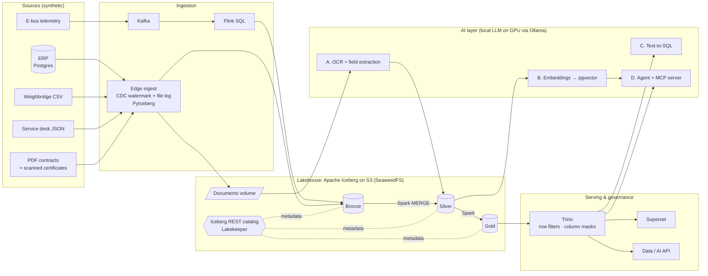

# Architecture

## Why these pieces

| Concern | Choice | Why |
|---|---|---|
| Table format | **Apache Iceberg 1.12** | Engine-neutral: written by Spark, Flink and PyIceberg, read by Trino. Managed platforms read it natively too, so the same data can move between a managed lakehouse and this stack. |
| Catalog | **Lakekeeper** (Iceberg REST) | Small, Apache-licensed REST catalog. Every engine talks to the same endpoint, so there is one source of table metadata. |
| Object storage | **SeaweedFS** (S3 API) | Apache-licensed S3-compatible storage. Any S3 service works the same way. |
| Batch processing | **Spark 4.1 via Spark Connect** | `MERGE INTO`, window functions and Iceberg maintenance procedures. Python clients only need the thin `pyspark-client`. |
| Streaming | **Kafka 4.4 → Flink 2.1** | Flink's Iceberg sink commits on checkpoints, so data becomes queryable within about 30 seconds without a separate loader. |
| Query + governance | **Trino 484** | One place for row filters and column masks (`infra/trino/etc/security/rules.json`). They apply to dashboards, the API, text-to-SQL and the agent alike. |
| Orchestration | **Dagster** | Assets with lineage, data-quality checks, schedules. |
| LLM serving | **Ollama** on the GPU | Local, offline, with structured outputs (JSON schema) and tool calling. |
| Vector search | **pgvector** | No extra service, and SQL access. The index can be rebuilt from Iceberg. |

## Layers

| Layer | Tables | Written by |
|---|---|---|
| Bronze | `erp_*` (CDC rows), `weighbridge`, `ticket`, `document`, `ebus_telemetry`, `ingest_file_log` | PyIceberg (edge), Flink (stream) |
| Silver | `tenant`, `plot`, `employee`, `asset`, `purchase_order` (MERGE), `weighbridge`, `ticket`, `ebus_telemetry`, `document_text`, `document_fields` | Spark, AI layer |
| Gold | `tenant_overview`, `weighbridge_daily`, `ticket_sla`, `contract_expiry`, `procurement_monthly`, `headcount`, `fleet_daily`, `bus_latest_position`, `document_chunk` | Spark, AI layer |
| Share | `tonnage_daily`: data products for parties outside the estate, with a fixed shape | Spark |

## Identity and governance

Trino trusts the `X-Trino-User` header, and its port is published on `127.0.0.1` only. The API maps API
keys to Trino users, Superset connects as `executive`, and the pipeline runs as `pipeline`. Rules are in
`infra/trino/etc/security/rules.json`, with groups in `groups.txt`:

| Identity | Sees |
|---|---|
| `admin` | everything |
| `executive` | Silver, Gold and Share; tenant contact details, tax IDs and employee contact details/national IDs masked |
| `analyst_finance` | Silver, Gold and Share; PII masked, national IDs and individual salaries hidden (NULL) |
| `tenant_t003` | only its own rows in tenant-facing Gold tables and shared fleet data; nothing else |
| `vendor_haulage` | `share.tonnage_daily` for tenants T002 and T005 only; nothing else |

Iceberg metadata tables (`$files`, `$partitions` and so on) are readable by admins only: their column statistics
(min and max values) would otherwise bypass the masks.

Writers (Spark, Flink, PyIceberg) go straight to the catalog with storage credentials. That is acceptable
inside a private network. For production, see [production.md](production.md).
