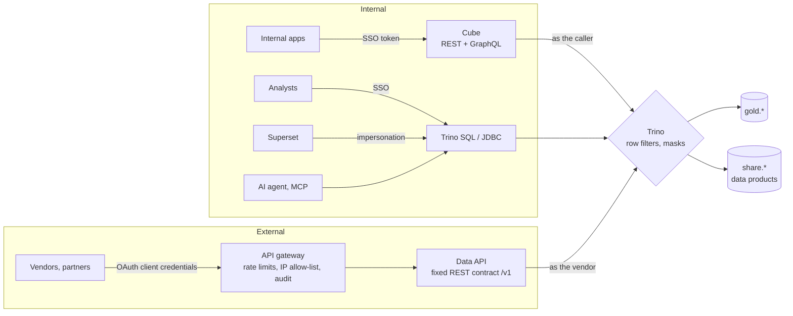

# From simulation to production

This repository is a reference implementation. It is deliberately small and runs on one machine.
This page lists what a real deployment needs.

| Area | In this repo | For production |
|---|---|---|
| Identity | Trusted `X-Trino-User` header, demo API keys | OIDC SSO (e.g. Keycloak brokering your identity provider, with MFA) for Trino, Superset, the API and the MCP server. Superset impersonates the logged-in user. |
| Catalog security | Lakekeeper with `allowall` authorization | Lakekeeper's OpenFGA authorization, or another REST catalog with fine-grained grants. Vended or short-lived storage credentials instead of static keys. |
| Policies | Trino file-based rules | The same rules in a policy engine with an audit trail (e.g. Apache Ranger or OPA). Keep them as code and review changes. |
| Encryption | Plain HTTP on localhost | TLS everywhere through a reverse proxy, TLS for Kafka, and encryption at rest on object storage. |
| Availability | Single containers | Kubernetes with the official Helm charts (Trino, Superset, Dagster, Flink operator), replicated object storage, Postgres with backups. |
| Table maintenance | Weekly compaction and snapshot expiry job | Tune per table: compaction targets, snapshot retention, orphan-file cleanup, and partitioning by query pattern. |
| AI quality | Validation rules, review queue, trace table | An evaluation set of real questions and documents, scored per model and prompt version before changing either. Guardrails for prompt injection inside documents. Human sign-off on extracted contract terms. |
| AI serving | Ollama on one GPU | vLLM or another inference server with batching on dedicated GPUs, an LLM gateway (rate limits, cost tracking, model routing) and redundancy. |
| Vector search | pgvector in the shared Postgres | A dedicated pgvector instance or a vector database once the volume grows. Keep Iceberg as the source of truth. |
| Observability | Logs, Dagster checks | Metrics (Prometheus/Grafana), central logs, alerting on check failures and data freshness. |
| Lineage & catalog | Dagster asset lineage | OpenLineage into a data catalog (e.g. OpenMetadata or DataHub) for business glossary and ownership. |

## Serving data to applications: internal and external

Every consumer reads from the same governed tables. The access path depends on how far the consumer can be
trusted and how stable its needs are. All paths end in Trino, so **one set of rules decides which rows and
columns each identity sees**. API layers handle authentication, API shape, caching and rate limits; they do not
decide who sees what.

| | Internal applications | External parties (vendors, partners, tenant portals) |
|---|---|---|
| Identity | Company SSO, one identity per person or per application | One OAuth client per party, short-lived tokens, revocable |
| API shape | Flexible: Cube (REST, GraphQL, SQL API) or Trino SQL for analysts | **REST with a fixed, versioned contract** (`/v1/...`), documented with OpenAPI |
| Free-form queries | Allowed: rules still apply | **Not exposed**: hard to audit and easy to overload |
| Data exposed | Silver and gold, per role | Only **`share.*` data products**: tables built for sharing, with a documented shape that does not change when internal tables do |
| Extra protection | Trino rules | API gateway (e.g. Kong or Apache APISIX): rate limits, quotas, IP allow-lists, per-party logs |
| Change management | Fast iteration | Deprecation policy: `/v2` next to `/v1` for an announced period |
| Large volumes | SQL or Cube | Not through an API: give the partner read access to the Iceberg tables (their engine reads them in place) or schedule exports |

### The example in this repository

- **Data product.** `share.tonnage_daily` holds trucks and net tons per tenant per day. The gold step builds it
  from `gold.weighbridge_daily` (`pipeline/transform.py`, `SHARE`).
- **A fictional vendor.** `vendor_haulage` hauls for tenants T002 and T005. The vendor's whole access is two
  rules in `infra/trino/etc/security/rules.json`: SELECT on `share.tonnage_daily` filtered to those two
  tenants, and nothing else.
- **External path.** `GET /v1/share/tonnage?days=30` on the Data API, with the vendor's API key.
- **Internal path (optional).** `make cube-up` starts Cube with the model in `infra/cube/model`. Every request
  carries a signed token whose `trino_user` claim names the caller. Cube verifies the token, then runs the
  query in Trino *as that user* (`driverFactory` in `infra/cube/cube.js`). It keeps compiled models and caches
  per identity, so one caller's cached result is never served to another.
- **Try it.** `make cube-demo` sends the same questions through Cube REST, Cube GraphQL and the Data API, as
  the vendor and as the executive. It also tries requests without a token, with a forged token and for an
  identity Cube does not serve.

Onboarding a new party is configuration, not code, while the data it needs already exists as a data product:

1. The data owner approves the request: which data, for what purpose, until when.
2. IT adds the identity to the gateway or identity provider.
3. IT adds one rule in the policy engine that grants the data product with a row filter.

Code is needed only for a new data product: one more `share.*` table and, for external parties, one more REST
endpoint.

For production:
- Cube verifies tokens from the identity provider (`CUBEJS_JWK_URL`), not a shared secret.
- Cube runs without dev mode (no Playground), behind TLS.
- Cube uses Cube Store if pre-aggregations are added.

## Interoperability with managed platforms

Iceberg is the common format of the major managed lakehouse platforms. Keeping data as Iceberg tables in
storage you own, behind an Iceberg REST catalog, means:

- a managed platform can be the primary engine while this open-source stack reads the same tables, as a
  standby or for specific workloads;
- moving between platforms is a catalog and compute change, not a data migration.

Keep one writer per table, which means one catalog in charge of commits. Keep pipeline logic in portable SQL
or PySpark. Keep governance rules as code, so they can be re-applied on another engine.
